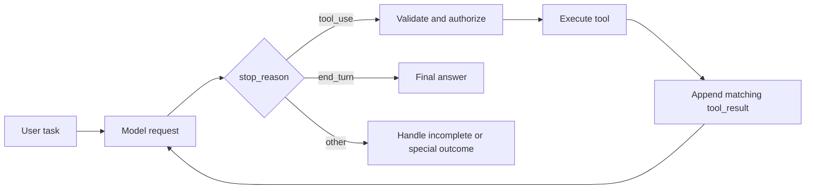

# Domain 1: Agentic Architecture & Orchestration

## 1.1 The agent loop: reasoning proposes, the harness executes

An agent combines a model, instructions, tools, conversation history, and a runtime that executes the loop. The model decides which permitted action may advance the task. The runtime sends requests, validates calls, performs operations, returns evidence and enforces limits. A deterministic workflow chooses its transitions in code. A tool-using agent chooses some transitions dynamically. Use autonomy when the next useful action depends on observations; use an ordinary workflow when the steps and branching conditions are already known.

Consider a support request: "My parcel is missing and I was charged twice." A fixed lookup sequence may miss the billing concern. An agent can identify two concerns and choose appropriate investigations. It still must not decide that an unverified person owns an order. Authentication and money movement belong to trusted services.

With client tools, a Messages API request does not execute your Python function. Claude returns a `tool_use` content block. Your application executes it and sends a matching `tool_result` block in a user message. The next request contains the original user message, complete assistant response, and results. The Agent SDK supplies a runtime that manages this loop; it does not remove your business-service responsibilities.



The loop inspects protocol fields, not language such as "done". A response may include text and several tool requests together. Text does not make the task complete. Preserve every content block, including nontext blocks, and send one result for each tool-use ID. Gather parallel-call results into the next user message. Do not add unrelated user text before the required result blocks.

`end_turn` is a normal model-turn completion. It does not prove a business transaction succeeded or all user concerns were addressed. `tool_use` requires tool handling. `max_tokens` indicates truncation, not success. Refusal and server-tool pause outcomes need explicit handling. The reference loop reports special outcomes as incomplete so its caller can apply a policy; it intentionally does not implement automatic server-tool continuation.

A turn cap, deadline and token/cost budget protect resources. Reaching a cap must produce an incomplete status and preserve progress. Increasing the cap is appropriate only after diagnosing why useful progress requires more turns. It is not a substitute for completion criteria.

## 1.2 Coordinators and coverage

A coordinator owns the whole user outcome: it decomposes scope, assigns work, controls information flow, checks evidence, handles failures and synthesizes a response. A worker owns a bounded task. In a hub-and-spoke design, workers return to the coordinator instead of inventing side conversations. This makes provenance, recovery and costs observable.

For a research comparison, assign distinct coverage such as pricing, operational requirements, and migration constraints. Give every worker the question, relevant prior findings, allowed sources, required output fields, and deadline. A worker reporting `status=complete` means its assigned work ended; it does not prove that the assignments covered the full question. Maintain a coverage matrix against the original requirements, then re-delegate precise gaps.

Avoid spawning every specialist for every request. A simple known answer may require no delegation. Extra workers create more token use, latency, conflicting assumptions and aggregation work. Measure the benefit of parallelism rather than assuming more agents improve quality.

## 1.3 Subagents, context and spawning

Subagents have isolated conversational context. Do not assume the child sees the coordinator's earlier searches, authentication state, or another worker's report. Even where runtime instructions are inherited, task-specific findings still need an explicit handoff.

A useful task contract contains `task_id`, objective, scope, source inputs, constraints, expected evidence schema and completion condition. A result contains status, findings, source locators, covered topics, limitations, errors and suggested next action. Separate content from metadata so a synthesis step cannot accidentally discard URLs, page numbers or dates.

```json
{
  "task_id": "billing-01",
  "status": "partial",
  "covered_topics": ["charge_history"],
  "findings": [{"claim": "Two captures observed", "source": "ledger:E-8"}],
  "errors": [{"code": "REFUND_STATUS_TIMEOUT", "retryable": true}],
  "missing_topics": ["prior_refund_status"]
}
```

The exam blueprint uses the historical `Task` spawning name. Current Agent SDK examples use `Agent`; inspect your installed runtime and keep this terminology distinction clear. `AgentDefinition` supplies a description for selection, a task prompt and an explicit `tools` list. Top-level `allowed_tools` preapproves tools; it is not an exclusive tool list. See [SDK guidance](../../docs/ANTHROPIC_SDK.md) for the current `tools`, permissions and `setting_sources` options.

Independent read tasks can run in parallel. Dependent work must wait: synthesizing before evidence arrives is a dependency bug. Two workers mutating one ledger also need serialization or transactional coordination even if their natural-language assignments look independent.

## 1.4 Enforce workflow prerequisites in code

An instruction to verify identity is helpful guidance, but a refund service must reject an unauthorized request even if the model ignores that instruction. Keep authentication context outside model-supplied arguments. Recheck ownership, policy, amount, prior refunds and approval status at the service boundary.

The reference `RefundService` receives `authenticated_customer` from a trusted caller, checks the requested order belongs to that identity, accepts positive integer cents, and prevents cumulative refunds from exceeding the paid amount. A lock makes the in-memory check-and-update indivisible within one process. A production ledger needs a durable database transaction, unique constraints and payment-provider reconciliation.

Idempotency means a repeated logical request returns the original outcome rather than repeating its effect. Store a key with a request fingerprint. Reusing a key with different arguments is an error. If a remote write times out, its outcome is **unknown**: it may have committed before the connection failed. Look up the original operation or retry using the same provider-supported key. A new key may create a duplicate payment.

Escalation is also a designed workflow. Give a human the verified identity, separate concerns, observed evidence, operations attempted, committed transaction IDs, remaining uncertainty and required decision. "See chat" is inadequate when the human lacks the transcript.

## 1.5 Hooks: prevention and observation

`PreToolUse` can inspect a proposed call before execution. Use it for argument checks, prerequisite gates and contextual restrictions. `PostToolUse` can normalize a returned timestamp, attach audit context or check response shape. It cannot undo a refund that has already committed.

Hook matching and return shape are part of the API contract. For critical pre-execution hooks, check supported fail-closed configuration such as `HookMatcher(on_failure="block")`. A callback exception is not automatically proof the action was denied. Exercise valid denial, callback crash, invalid response and direct service invocation. The service must remain safe even if the SDK hook is absent.

Do not describe a formatting hint as actual normalization. Appending "use UTC" does not convert a timestamp. Parse and normalize in an adapter, preserving an explicit error when input is invalid. Audit data should identify tool call, policy version and outcome without logging credentials or unnecessary personal information.

## 1.6 Task decomposition and execution patterns

Choose a pattern by dependency and uncertainty:

| Pattern | Suitable case | Main failure to prevent |
|---|---|---|
| Prompt chain | Extract, validate, then summarize | Passing invalid output to the next stage |
| Routing | Select billing or shipping investigation | Ambiguous routing descriptions |
| Parallelization | Independent billing and delivery reads | Shared-state races or duplicated research |
| Orchestrator-workers | Unknown research subtasks discovered at runtime | Incomplete original scope |
| Evaluator-optimizer | Improve a candidate against measurable criteria | Endless subjective "make it better" loops |

Separate user concerns before optimizing execution. Investigate missing delivery and duplicate charge separately, then produce one unified response. Distinguish task dependencies from a preferred presentation order. A final report may discuss shipping first even when billing completed first.

Define evaluator criteria before iterating: all required topics covered, source references present, no unresolved high-impact contradictions, arithmetic validated. Stop when criteria are met or resource limits require an honest partial result. A model's self-confidence is not an independent evaluator.

## 1.7 Sessions, resumption and forks

A session preserves conversation continuity. It does not restore the filesystem, database state, authentication lifetime or payment ledger. Capture the session ID from SDK events/results. Resume by ID when continuing the same investigation; fork when comparing alternatives from the same conversational baseline.

Forks isolate history, not necessarily files. Two forked coding sessions in the same directory can still overwrite each other's work. Use separate checkouts when branches will modify files. Before acting on resumed findings, re-read mutable files and revalidate authoritative business state.

Keep a durable manifest containing the base commit, completed tasks, evidence artifact paths, unresolved questions and next actions. A transcript helps reasoning; the manifest helps recovery. Neither authorizes an irreversible operation. Domain 5 develops this separation further.

## A worked design decision

Requirement: issue a refund only for the authenticated customer's paid, eligible order, and handle a duplicate network submission. Put lookup and customer concerns in agent context, but implement the authorization and ledger transition in the refund service. Use a stable operation key chosen by the application for the confirmed request. On retry return the same receipt. If the model says "refund completed" without a committed receipt, the final response must not adopt that claim.

Read [the implementation](../../ccarf/architecture.py), then design the failure cases in [the exercises](EXERCISES.md). Official API details: [tool handling](https://platform.claude.com/docs/en/agents-and-tools/tool-use/implement-tool-use), [Agent SDK reference](https://code.claude.com/docs/en/agent-sdk/python), [hooks](https://code.claude.com/docs/en/agent-sdk/hooks), [sessions](https://code.claude.com/docs/en/agent-sdk/sessions). Original teaching synthesis draws on supplied PDF P1 in [sources](../../docs/SOURCES.md).
