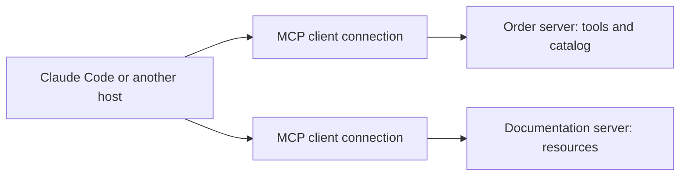

# Domain 2: Tool Design & MCP Integration

## 2.1 A tool is a decision contract

A good tool interface tells the model when it is relevant and tells the application how to validate execution. A Python signature alone is insufficient. Define purpose, selection boundary, inputs, returned evidence, failure semantics and side effects. "Manage orders" leaves the model guessing whether the tool reads, cancels or refunds. `lookup_order` and `request_refund` make the decision boundary explicit.

Tool names and descriptions interact with system instructions. If two tools have nearly identical descriptions, raising model temperature or adding a vague "choose carefully" instruction will not reliably fix misrouting. Inspect actual traces, identify the ambiguity, rewrite the contracts, and evaluate cases that distinguish their purposes.

For example, a lookup contract should say it requires an exact order identifier, returns status and amount, does not issue refunds, and returns `null` for no accessible match. A refund contract should describe identity requirements, policy eligibility, integer cents, idempotency key, receipt state, and unknown-outcome recovery. Descriptions should be detailed where the decision is difficult, without filling context with irrelevant backend implementation.

Use JSON Schema to express shape: required properties, allowed values, numeric bounds and `additionalProperties: false` when appropriate. Validate again in Python. Schema correctness cannot establish that an order belongs to the authenticated user, an account may be accessed, or a transaction is within policy. The schema is an input contract; the service enforces authority.

Split tools when they have different side effects or selection logic. Consolidate operations when a single coherent read avoids repeated ambiguous calls. Avoid both a universal `do_action` tool and dozens of tiny tools that expose an implementation detail for every field.

## 2.2 Error semantics determine the next action

An empty successful query and a failed query are different observations. `ok=true, data=[]` says the source was searched and nothing matched within scope. A timeout says the evidence is unavailable. Returning an empty list on timeout invents negative evidence.

Distinguish protocol failures from tool execution failures. MCP protocol errors describe a malformed/unsupported protocol request or transport-level problem. A valid tool invocation that fails at the application layer should return an execution result with error indication and useful structured information. In a Messages client-tool loop, put `is_error: true` on the matching `tool_result`. Internal application envelopes such as `ok/error` are useful but do not replace the wire protocol's error representation.

```json
{
  "ok": false,
  "error": {
    "category": "transient",
    "code": "ORDER_READ_TIMEOUT",
    "retryable": true,
    "message": "Order service did not respond"
  },
  "attempts": 2,
  "partial_findings": []
}
```

| Category | Example | Appropriate recovery |
|---|---|---|
| Transient | Read timeout or temporary overload | Bounded backoff; respect retry guidance |
| Validation | Malformed order ID | Correct arguments or ask for an identifier |
| Authorization | Credential lacks access | Repair permissions or escalate; avoid blind retries |
| Business rule | Order is ineligible | Explain policy or seek authorized exception |
| Unknown write outcome | Payment response lost | Reconcile original operation using its stable key |

A `retryable` flag is guidance, not a reason to ignore operation semantics. A read can often be retried safely. A write requires provider-supported idempotency and reconciliation. Bound attempts and elapsed time. Production backoff should include jitter so many clients do not retry simultaneously. Return the attempts, partial evidence and unresolved error to the coordinator when local recovery ends.

The reference `retry_read` deliberately handles reads only. It catches the expected timeout type rather than converting every programming error into a plausible empty result. Unexpected contract violations should remain observable failures.

## 2.3 Tool scope and tool selection

A research worker needs search and fetch; a payment worker needs narrow account-scoped actions. Giving every worker every tool makes selection harder and increases the impact of a mistake. Start with the smallest useful tool set for the role, then enforce underlying permissions independently.

In the Messages API, `tools` defines tools offered for the request. The conceptual `tool_choice` modes are: `auto` lets the model choose whether to call, `any` requires some tool, named `tool` requires a particular tool, and `none` prevents tool use. Support depends on the selected model and settings. Some current configurations reject forced modes. Learn the architectural distinction while checking the current compatibility matrix before using a concrete request.

Strict tool input schemas constrain arguments when supported. They do not cause `auto` to invoke the tool. Requiring a lookup as the next step also does not prove a later refund will follow every prerequisite. Deterministic workflow gates still belong to application code.

Agent SDK permission terminology is different: `allowed_tools` preapproves specified calls. It does not hide all other tools. Use an explicit `tools` list, `disallowed_tools`, per-subagent tool restrictions and underlying filesystem/service permissions as required. Do not copy a Messages API selection rule into an Agent SDK permission decision without checking its meaning.

## 2.4 MCP architecture and integration

MCP standardizes how hosts connect to capabilities. A host is the AI application managing the user interaction. It uses MCP clients to connect to servers. A server exposes tools, resources and prompts. One host can maintain several server connections; a server is not the model and does not inherently run an agent.

Tools perform callable operations. Resources expose addressable content such as a policy document, schema or catalog. Prompts provide reusable interaction templates. A resource catalog can reduce blind exploration: the agent can discover available policy versions before choosing a specific resource or tool.



Choose stdio for a locally launched process. Stdout carries the protocol, so write diagnostics to stderr. Choose Streamable HTTP for a remotely hosted service with multiple clients and an appropriate authentication/deployment design. HTTP/SSE is a legacy transport you may encounter; do not make it the default for a new remote integration without a compatibility requirement.

Claude Code distinguishes local, project and user MCP scopes. Project configuration in `.mcp.json` is suitable for a reviewed team integration. Local scope is private to one project/user environment; user scope makes a server available across that user's projects. Shared configuration should contain executable/environment references rather than embedded credentials. A committed file existing on disk does not mean every teammate has credentials, dependencies, or has approved the server.

Prefer a maintained, appropriate existing server for a standard integration after checking authentication and capability fit. Build custom tools for your domain contracts. Review tool trust boundaries, server update process, tenant isolation, pagination and error behavior. A standard protocol does not make a server's content trustworthy.

The pinned MCP Python SDK is v2 and uses `from mcp.server import MCPServer`. Many older examples use `FastMCP`; that belongs to a different version/API. [The runnable server](../../examples/mcp_order_server.py) uses the pinned v2 package. A new install that follows old imports is an integration issue, not a model reasoning issue.

## 2.5 Use the right codebase tool

| Need | Tool | Reason |
|---|---|---|
| Locate files by name or extension | Glob | Matches paths |
| Find callers or error text | Grep | Searches file contents |
| Inspect exact implementation | Read | Supplies evidence and context |
| Change one unique block | Edit | Limits modification scope |
| Replace a deliberately reviewed full file | Write | Handles full-file content |
| Run a test or shell command | Bash | Executes a process |

Explore progressively. Find an entry point, inspect it, follow imports and wrapper aliases, search all exported names, and inspect relevant tests. A function may be called through a re-exported name, so searching only the original definition misses part of the path.

If Edit reports an ambiguous anchor, first re-read the file and identify a unique surrounding block. A full-file rewrite can be a fallback after reading current contents and preserving concurrent changes; do not repeatedly guess a shorter ambiguous anchor. When tracing a bug, retain path, function and revision evidence so later summaries remain grounded.

## A worked contract revision

Bad: `customer_action(text)` with description "Handle customer problems". It mixes identity lookup, policy decisions and writes, accepts unstructured arguments and has no reliable receipt semantics.

Better: `lookup_order(order_id)` returns accessible order evidence; `request_refund(order_id, amount_cents, operation_key)` performs a gated write; `escalate_case(packet)` transfers a structured unresolved case. The authenticated principal comes from the runtime. The model cannot create authorization by writing `verified=true`.

Read [tools.py](../../ccarf/tools.py), then complete [the exercises](EXERCISES.md). Sources: supplied PDF P2, [official tool handling](https://platform.claude.com/docs/en/agents-and-tools/tool-use/implement-tool-use), [Claude Code MCP](https://code.claude.com/docs/en/mcp), [MCP Python SDK](https://github.com/modelcontextprotocol/python-sdk), and [source register](../../docs/SOURCES.md).
